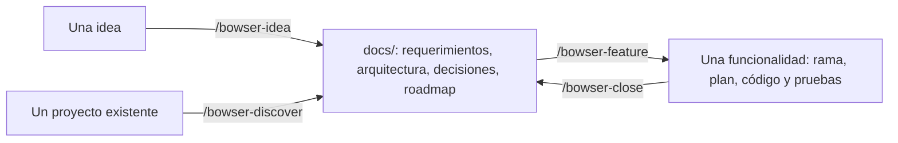

# 1. Qué es y cómo piensa

[← Inicio](README.md)

## El problema que resuelve

Un agente de IA escribe código rápido, pero solo no sabe lo que tu proyecto no dice en el código (por qué una tabla es así, qué se rompió la última vez), dice que algo funciona sin haberlo visto funcionar y, si nadie lo frena, se salta las pruebas. Eso es el *vibecoding*: código que nadie entiende del todo, que pasa porque nadie lo revisó.

bowser-ai-lite pone tres cosas alrededor del agente:

1. **Un método**: cada cambio pasa por entender, planear (según su tamaño), construir con pruebas, comprobar, revisar y cerrar.
2. **Una memoria del proyecto**: archivos en `docs/` que dicen lo que el código no dice, y que el agente lee cuando le hacen falta y actualiza al cerrar.
3. **Controles que no dependen del agente**: hooks de git, `make verify` y un CI que frenan lo que no cumple, aunque el agente (o una persona) quiera saltárselo.

## Las ideas

**Un agente fuerte hace el trabajo.** El agente `constructor` entiende, planea, programa, prueba y entrega. No reparte el trabajo en una cadena de agentes que se pasan documentos. Tiene dos ayudantes: `@explorador`, que lee mucho código y lo resume barato, y `@revisor`, que revisa al final sin haber visto la conversación. Ver [Agentes](06-agentes.md).

**La ceremonia depende del tamaño.** Corregir un texto no necesita un plan. Cambiar cómo se cobra, sí.

| Tamaño | Ejemplos | Qué pasa |
|---|---|---|
| Pequeño | Un error, un texto, un ajuste que no cambia datos ni permisos | Directo a construir |
| Normal | Una funcionalidad acotada | Plan de una página; el agente lo muestra y sigue salvo que lo frenes |
| Grande | Datos de clientes, pagos, permisos, seguridad, cambios de esquema, reconstruir un módulo | Spec y plan, y **espera tu aprobación** antes de programar |

Tocar migraciones, autenticación, permisos o pagos lo hace grande aunque parezca pequeño, y eso lo comprueba `make verify`, no el agente.

**Evidencia antes que documentos.** Apruebas viendo pruebas en verde y la aplicación funcionando, no leyendo planes largos. El agente tiene que decir qué vio funcionar.

**Memoria pequeña y curada.** Solo lo que el código no dice y seguirá siendo cierto. Una memoria vieja es peor que ninguna, por eso `/bowser-close` la pone al día en cada funcionalidad y `make verify` avisa cuando un cambio la deja vieja. Ver [Memoria](07-memoria.md).

**Nada vive solo en la conversación.** La conversación se puede perder (un corte, un reinicio, una sesión demasiado larga). Lo que importa se commitea: el plan con su sección **Estado**, cada paso terminado, la memoria. Por eso `/bowser-resume` puede seguir sin que le expliques nada.

**Una persona decide lo irreversible.** El agente corre pruebas y comandos sin pedir permiso, pero subir cambios (`git push`), hacer merge y desplegar los decide una persona.

## Proyecto nuevo o existente: el mismo formato

Los documentos tienen un formato fijo (`.bowser/documentacion.md`): requisitos `RF-NN` con criterios *Dado / Cuando / Entonces*, diagramas en Mermaid y decisiones `D-NN`. Sirve igual para un proyecto que nace de una idea y para uno que ya existe. Lo único que cambia es de dónde salen:

## Qué no es

- **No es un generador de proyectos**: no trae plantillas de código. El código lo escribe el agente con la tecnología que elijas.
- **No reemplaza tu criterio**: te pregunta lo que cambia el resultado y espera tu aprobación en lo grande. Si apruebas sin leer, el kit no lo puede evitar.
- **No despliega**: llega hasta una rama lista para merge. Desplegar sigue siendo cosa tuya.
- **No funciona con otras herramientas**: está hecho para OpenCode. La memoria es Markdown en git, así que no queda atada a él.

Siguiente: [2. Instalar](02-instalar.md)
