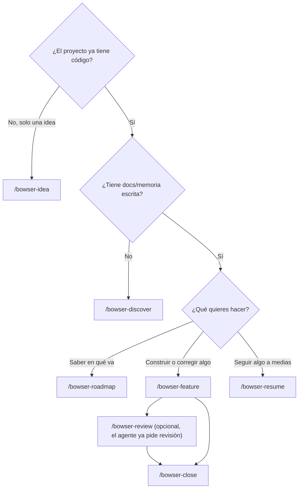

# 3. Elegir el comando

[← Inicio](README.md)

Todos los comandos se escriben en OpenCode, abierto en la carpeta del proyecto. Después del nombre puedes escribir lo que quieras en lenguaje normal: el comando lo recibe como tus notas.

## Por dónde empiezo

## Según la situación

| Situación | Escribe | No uses |
|---|---|---|
| Tienes una idea y una carpeta vacía | `/bowser-idea <la idea>` | `/bowser-feature`: sin requerimientos, el agente inventa |
| Heredaste un proyecto o el tuyo no tiene memoria | `/bowser-discover` | `/bowser-idea`: escribe desde cero, ignorando lo que ya existe |
| Vuelves después de días y no recuerdas en qué ibas | `/bowser-roadmap` | `/bowser-resume`, salvo que sepas que hay algo a medias |
| Quieres agregar, partir, reordenar o descartar funcionalidades del plan | `/bowser-roadmap` y responde que sí a replanear | Editar `roadmap.md` a mano sin actualizar los `RF` |
| Quieres construir la siguiente del roadmap | `/bowser-feature #3 del roadmap: <nombre>` | |
| Encontraste un error | `/bowser-feature el total del carrito no suma el envío` | Pedírselo al agente sin comando: se salta el método |
| Un cambio chico (un texto, un color) | `/bowser-feature cambia "Enviar" por "Guardar" en el formulario de perfil` | |
| Se cortó internet, se reinició la PC o cerraste OpenCode a mitad | `/bowser-resume` en una sesión nueva | Volver a pedir la funcionalidad: duplicarías trabajo |
| La conversación se hizo muy larga y el agente se confunde | Sesión nueva y `/bowser-resume` | |
| Quieres una segunda opinión sobre lo que hizo el agente | `/bowser-review` | |
| Revisaste lo entregado y está bien | `/bowser-close` | Hacer merge sin cerrar: la memoria queda vieja |
| Quieres saber cuánto llevas gastado | `/bowser-cost` (o `make cost`) | |
| Quieres saber si la rama se puede cerrar | `make verify` | |
| Salió una versión nueva del kit | `/bowser-update` (o `bowser update`) | |

## Reglas que conviene seguir

- **Una sesión de OpenCode por funcionalidad.** Una conversación larga cuesta más tokens por respuesta y el agente se confunde. El estado está en git, así que empezar una sesión nueva no pierde nada.
- **Empieza en la rama principal.** `/bowser-feature` crea su rama. `/bowser-roadmap` y `/bowser-update` hacen sus commits en la rama principal y te preguntan si estás en otra.
- **El push y el merge son tuyos.** El agente te pregunta antes de `git push`. Revisa la rama (o pide `/bowser-review`) antes de hacer merge.
- **Responde lo que pregunta.** Cada pregunta del agente lleva su recomendación; puedes responder "sí" o "la 2 no, la 4 sí".

Siguiente: [4. Un día de trabajo](04-un-dia-de-trabajo.md)
