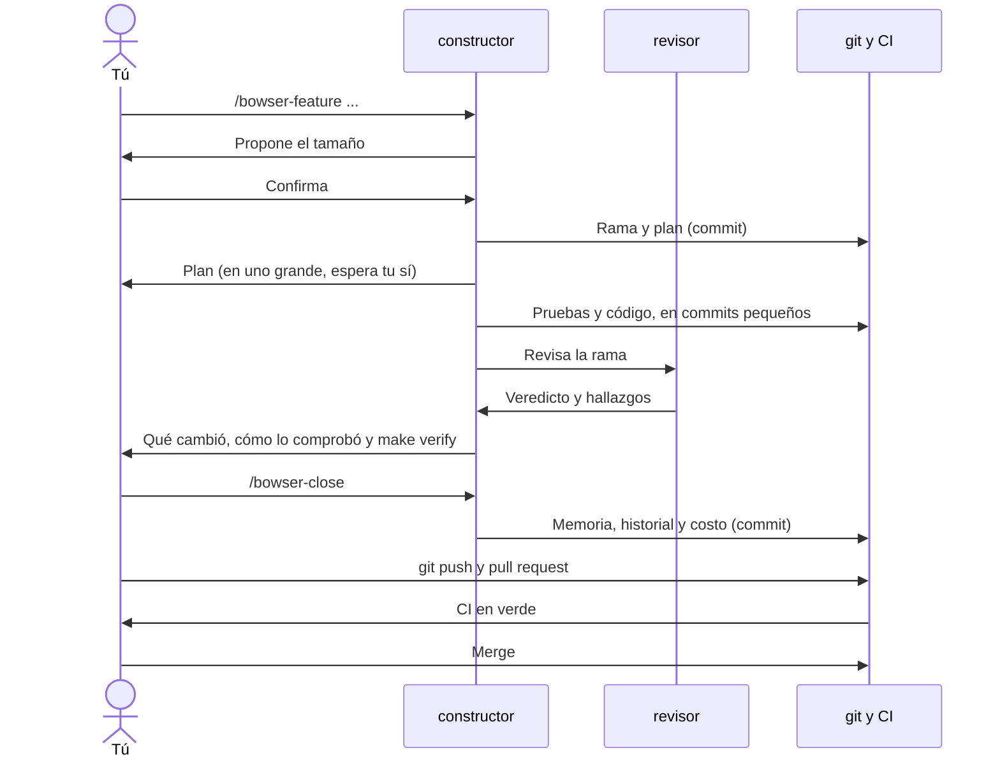

# 4. Un día de trabajo

[← Inicio](README.md)

Un ejemplo completo, con un proyecto inventado: una app para que los talleres mecánicos agenden citas. Lo que escribes tú va en bloques de código; lo demás es lo que hace el kit.

## El ciclo de una funcionalidad



## Lunes: de la idea al plan

```bash
mkdir talleres && cd talleres && git init -b main
bowser init
opencode
```

```
/bowser-idea una app para que los talleres agenden citas y avisen al cliente cuando el auto está listo
```

El agente pregunta en rondas cortas: quién la usa (el dueño del taller, el mecánico, el cliente), qué es lo mínimo que ya sirve, si se guardan datos personales, dónde va a correr, qué tecnología. Cada pregunta trae su recomendación.

Después te pregunta los estándares (código en inglés o en español, cómo se llama cada capa, cómo se organizan las carpetas) y te muestra el diseño por partes, para que lo apruebes antes de que exista una línea de código: las tablas (`talleres`, `citas`, `clientes`) con su diagrama, los módulos (`agenda`, `avisos`) y quién puede usar a quién, y las rutas principales con lo que reciben y devuelven. Aquí es donde corriges ("las citas van a crecer mucho: separemos el histórico").

Con todo eso escribe:

- `docs/producto/requerimientos.md`: la visión, los roles y requisitos como `RF-03 El cliente reserva una cita` con criterios *Dado / Cuando / Entonces*.
- `docs/memoria/convenciones.md`, `base-de-datos.md` y `modulos.md`: los estándares y el diseño que aprobaste.
- `docs/memoria/arquitectura.md`: el diagrama de contexto y de contenedores.
- `docs/memoria/decisiones.md`: por qué Go y PostgreSQL, por qué sin app móvil en la primera versión.
- `docs/producto/roadmap.md`: #1 base mínima, #2 agenda del taller, #3 reserva del cliente…

Te muestra un resumen de 20 líneas y espera tu aprobación. Después:

```bash
bowser init --skills go,react,postgres
```

## Martes: la base mínima

Cierra OpenCode, ábrelo de nuevo (sesión nueva) y escribe:

```
/bowser-feature #1 del roadmap: base mínima
```

1. **Tamaño.** Propone "normal" y pide que lo confirmes.
2. **Plan.** Crea la rama `feat/base-minima` y escribe `docs/cambios/base-minima.md` (qué se pide, cómo se hace, cómo se comprueba y una sección **Estado**). Lo commitea antes de tocar código y te lo muestra en pocas líneas.
3. **Construir.** Escribe la prueba, luego el código, en commits pequeños. Cada paso terminado actualiza el Estado del plan.
4. **Comprobar.** `make check` en verde, levanta la app con `make run` y te dice qué vio.
5. **Revisar.** Pide a `@revisor` que revise la rama. Corrige lo bloqueante.
6. **Entregar.** Corre `make verify` y te muestra el resultado:

```
Verificación de la rama feat/base-minima contra main · 14 archivos cambiados
  ✓ make check pasa
  ✓ cambia código (9 archivos) y pruebas (2)
  ✓ no toca archivos riesgosos
  ✓ el revisor revisó la rama
  ⚠ memoria: hay carpetas de código nuevas (cmd, internal) y no se actualizó docs/memoria/arquitectura.md

✓ La rama se puede cerrar.
```

Pruebas la app tú mismo. Si está bien:

```
/bowser-close
```

Pone al día la memoria (el aviso de arriba incluido), anota en `docs/producto/historial.md` cuántos tokens costó y marca la #1 como terminada en el roadmap. Luego tú:

```bash
git push -u origin feat/base-minima
```

El hook corre `make check` antes de subir. Abres el pull request; el CI busca secretos, corre `make check` y comprueba pruebas y tamaño de la rama. En verde, haces merge.

## Miércoles: se corta la luz

Estabas en la #2, a mitad de construir. Vuelve la luz, abres OpenCode (sesión nueva) y escribes:

```
/bowser-resume
```

Mira la rama, los commits, la sección Estado del plan y los archivos sin commitear, corre las pruebas y te dice: "Hecho: la tabla de citas y su API. Sin commitear: el formulario, a medias, con una prueba fallando. Sigue: terminar el formulario. Pendiente de decidir: si un mecánico puede ver citas de otro." Le respondes y sigue.

## Un mes después

```
/bowser-roadmap
```

Te dice, sin tocar nada, qué está hecho, qué está a medias, las tres que siguen, las preguntas abiertas y la deuda de riesgo alto. Te pregunta si quieres replanear. Si dices "agrega pagos con tarjeta antes de la #5", propone la funcionalidad marcada como grande (toca pagos), con sus `RF`, te muestra la tabla nueva y espera tu sí.

## Un proyecto que ya existía

Si en vez de empezar de cero heredas un sistema en PHP de hace diez años:

```bash
cd sistema-viejo
bowser init --skills php,mysql
opencode
```

```
/bowser-discover
```

En la rama `docs/descubrimiento` recorre el sistema en seis pasadas, con un commit por pasada: qué tecnologías usa y cómo se corre; qué hace cada módulo y quién usa a quién (el mapa de `modulos.md`); el esquema de la base de datos (de las migraciones, o de un volcado que le pases); las convenciones y la deuda (sobre todo de seguridad); una prueba de entendimiento: lo levanta en local y te explica un flujo, de la pantalla a la base de datos, para que lo confirmes; y **cómo lo quieres de aquí en adelante**: te muestra las convenciones que encontró y te pregunta cuáles se quedan y cuáles cambian (idioma del código, nombres, cómo se llama cada capa, errores, carpetas). Si la sesión se alarga, para al final de una pasada y la siguiente sesión sigue donde quedó.

Desde ahí trabajas con `/bowser-feature` como en un proyecto nuevo. La diferencia: antes de cambiar código que no tiene pruebas, el agente escribe primero sus **pruebas de caracterización**, que fijan cómo funciona hoy, para que el cambio no rompa lo que nadie sabía que existía.

Siguiente: [5. Comandos](05-comandos.md)
