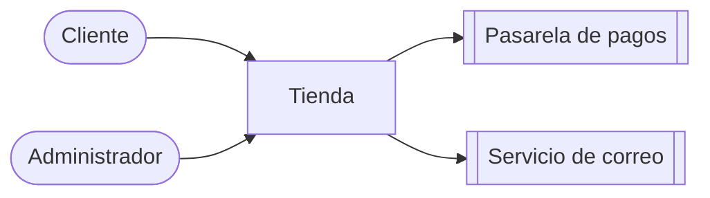
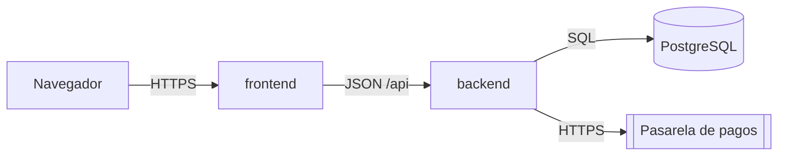
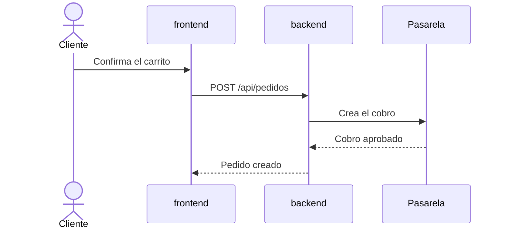

# Arquitectura

Cuándo leerlo: al tocar más de un módulo, o cuando no sepas dónde va algo.

<!-- Qué piezas tiene el sistema y cómo se conectan. Corto: el detalle está en el código.
     Diagramas en Mermaid y con los nombres del código; formato en .bowser/documentacion.md.
     Los diagramas de abajo son ejemplos: reemplázalos por los de este proyecto. -->

## Contexto
El sistema, quién lo usa y con qué sistemas externos habla.

## Piezas

| Pieza | Tecnología | Carpeta | Responsabilidad |
|---|---|---|---|
| <API> | <Go 1.27> | <`backend/`> | <Reglas de negocio y acceso a datos> |
| <Web> | <React 19> | <`frontend/`> | <Pantallas de clientes y administración> |
| <Base de datos> | <PostgreSQL 16> | <`backend/migrations/`> | <Datos del negocio> |

## Cómo se conectan
Las piezas que se despliegan y por dónde se hablan.

## Flujos clave
<!-- Los 2 a 5 flujos más importantes: pasos y archivos por los que pasan. Diagrama de secuencia solo si
     intervienen varias piezas, pagos o permisos. -->

### <Compra>
<1. El carrito se confirma en `frontend/src/carrito/`. 2. `backend/internal/pedidos/service.go` crea el pedido y pide el cobro. …>

## Despliegue
<!-- Dónde corre cada pieza, cómo llega el código ahí y qué variables de entorno necesita (sin valores). -->
