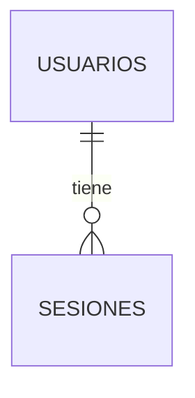

# Base de datos

Cuándo leerlo: cuando la tarea toque tablas, consultas, procedimientos o migraciones.

<!-- Se genera leyendo el esquema real (migraciones, script SQL o la base), no de memoria.
     Si una tabla cambia, este archivo cambia en el mismo commit. -->

Motor: <PostgreSQL 16>. Dónde está el esquema: <`backend/migrations/`>.

## Tablas

| Tabla | Para qué | Columnas clave | Relaciones |
|---|---|---|---|
| <usuarios> | <Cuentas de acceso> | <id, correo (único), creado_en> | <— > |

## Procedimientos, vistas y disparadores
<!-- Si los hay: nombre, qué hace y quién lo llama. -->

## Diagrama

