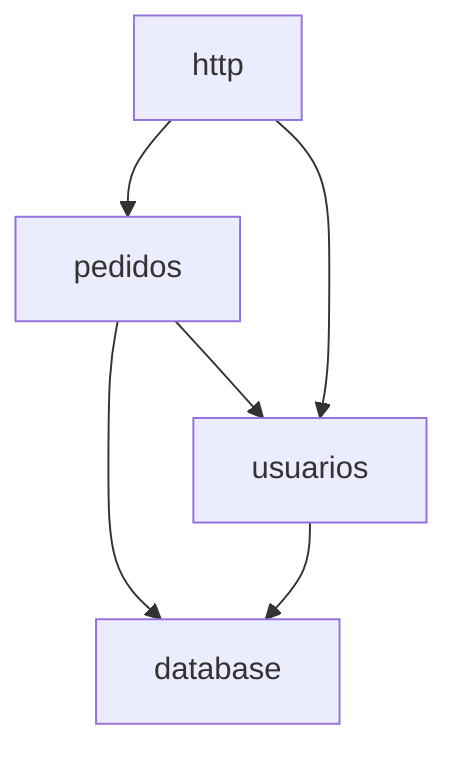

# Módulos

Cuándo leerlo: antes de tocar un módulo que no conoces, de agregar uno o de mover algo de un módulo a otro.

<!-- Qué hace cada parte del sistema y quién puede usar a quién. Las piezas que se despliegan están en
     arquitectura.md y las tablas en base-de-datos.md: aquí se enlazan, no se copian.
     Un módulo es una parte con una responsabilidad: un paquete, una carpeta o un área del negocio que vive en varias
     carpetas (en Laravel, `Services/Pagos/` + `Actions/Pagos/`). Solo las piezas que alguien buscaría, no todas.
     Si pasa de ~7 000 caracteres, deja aquí el índice y las fronteras entre servicios, y parte el resto en un
     archivo por servicio (modulos-api.md, modulos-web.md). Los ejemplos de abajo se reemplazan por los del proyecto. -->

## Quién usa a quién
Cada flecha es una dependencia real (un `import`, una llamada), con los nombres del código.

## Reglas
<!-- Las fronteras: quién puede usar a quién. Cada una dice si se cumple hoy o si es una regla nueva (con su D-NN).
     Lo que hoy no la cumple va a deuda.md. -->
- <Solo `database` escribe SQL: la entrada (`http`) pide a los módulos de negocio, nunca a la base. Se cumple hoy.>
- <`pedidos` usa a `usuarios` por su servicio, nunca leyendo sus tablas. Regla nueva (D-07).>

## <pedidos>
- **Propósito:** <qué hace, en una o dos frases.>
- **Piezas principales:** <`CrearPedido` (`internal/pedidos/crear.go`): valida el carrito y reserva el stock. …>
- **Lo llaman:** <`http`>. **Llama a:** <`usuarios`, `database`>.
- **Datos:** <lee `productos`; escribe `pedidos` y `pedidos_detalle`.>
- **Contrato:** <lo que ofrece hacia afuera: `POST /api/pedidos` (recibe el carrito, devuelve el pedido) o su interfaz pública.>

## Diseñado vs. construido
<!-- Solo si el proyecto tiene diseño previo (un documento por módulo, un plan de arquitectura). Qué de ese diseño ya
     existe en el código y qué falta, para no leer el diseño como si todo estuviera hecho. Si no lo hay, borra la sección. -->

| Diseño | Módulo | Estado | Roadmap |
|---|---|---|---|
| <`docs/diseno/pagos.md`> | <pagos> | <Por construir> | <#7> |
